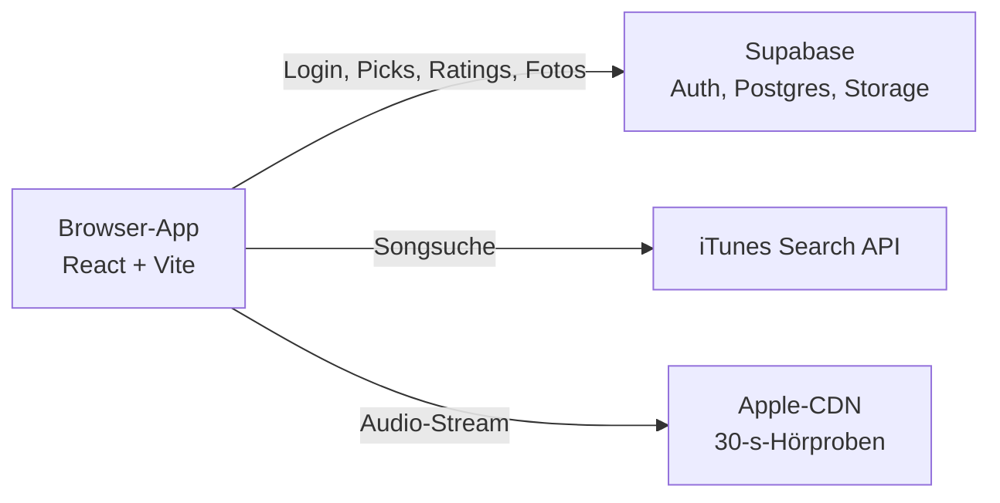

# Tapetausch

Arbeitstitel

Ein gemeinsames Musiktagebuch für einen festen Freundeskreis von 5 bis 10 Leuten. Jede Person teilt pro Woche genau einen Song, ihren Top Pick. Die anderen hören rein, bewerten und kommentieren.

Ein Pick bekommt zwei Wertungen von 1 bis 10: eine für die Qualität und eine für die emotionale Wirkung. Dazu kann man eine kurze Notiz und ein Foto vom Moment anhängen.

Das ist ein Hobbyprojekt für den eigenen Freundeskreis. Es könnte später wachsen, ist aber nicht darauf ausgelegt.

## Grundideen

- **Teilen steht im Mittelpunkt.** Picks sind sofort sichtbar und nicht hinter dem eigenen Post versteckt.
- **Knappheit gibt dem Pick Gewicht.** Es gibt nur einen Pick pro Woche, gepostet wird, wann man will.
- **Neu für die Freunde reicht.** Ein alter Lieblingssong zählt genauso wie eine frische Entdeckung.
- **Wenig Aufwand.** Ein Pick ist in etwa einer Minute gepostet, Bewerten ist freiwillig.
- **Die Erinnerung zählt.** Mit der Zeit entsteht ein Archiv aus Musik und Momenten.

## Features

Die erste Version hat vier Teile: Anmeldung, Pick posten, Feed und Pick-Detail. Alles Weitere wartet, bis die Gruppe die App ein paar Wochen benutzt hat.

### Anmeldung und Gruppe

- Registrierung mit eindeutigem Username, Passwort und Einladungscode, ohne E-Mail-Adresse
- Danach bleibt man eingeloggt
- Es gibt eine einzige Gruppe, Freundschaftsanfragen fallen weg
- Vergessene Passwörter setzt der Admin im Supabase-Dashboard zurück

### Pick posten

- Ein Pick pro Person und Woche (Montag bis Sonntag), zu einem frei wählbaren Zeitpunkt
- Song über die iTunes-Suche auswählen, mit Hörprobe direkt in der Suche
- Alben und EPs als Pick sind geplant, aktuell gibt es nur einzelne Songs

| Feld                                       | Pflicht | Stand  |
| ------------------------------------------ | ------- | ------ |
| Qualität (1–10)                            | Ja      | Drin   |
| Emotion (1–10)                             | Ja      | Drin   |
| Notiz: wie es sich anfühlt, der Moment     | Nein    | Drin   |
| Foto vom Moment                            | Nein    | Drin   |
| Woher man den Song hat                     | Nein    | Später |
| Was man besonders findet                   | Nein    | Später |
| Tag „gerade entdeckt“ oder „alter Favorit“ | Nein    | Später |

### Feed

- Zeigt die Picks der Gruppe, neueste zuerst
- Jeder Pick ist sofort sichtbar, unabhängig davon, ob man selbst schon gepostet hat
- Jeder Eintrag hat eine 30-Sekunden-Hörprobe und einen Link zu Apple Music
- Fehlt eine Hörprobe, funktioniert der Pick trotzdem, nur ohne Player

### Pick-Detail

- **Blindbewertung:** Die Wertungen der anderen sieht man erst nach der eigenen. Das gilt auch für die Wertung der Person, die gepostet hat.
- **Bewertet wird nur die Musik.** Der persönliche Moment bekommt keine Note.
- **Kommentare** gelten vorerst für den ganzen Pick, später eventuell für einzelne Felder.
- **Alles freiwillig:** Es gibt keine Zähler für noch nicht bewertete Picks.

## Geplante Erweiterungen

Merkliste und Sonntags-Erinnerung kommen zuerst, weil sie im Alltag am meisten helfen. Mehr tägliche Funktionen sind bewusst nicht das Ziel, sonst verliert der eine Pick pro Woche sein Gewicht.

| Erweiterung         | Wozu                                                                                                     | Wann            |
| ------------------- | -------------------------------------------------------------------------------------------------------- | --------------- |
| Sammlung            | Picks von Freunden in die eigene Sammlung überspielen; der Poster sieht, wie oft sein Pick kopiert wurde | Phase 3         |
| Sonntags-Erinnerung | Push-Hinweis, falls man noch nicht gepostet hat                                                          | Phase 3         |
| Kommentare pro Feld | Direkt auf einen einzelnen Punkt eines Picks antworten                                                   | Phase 3         |
| Reaktionen          | Kleinste mögliche Aktion, wenn man nicht kommentieren will                                               | Phase 3         |
| Weitere Pick-Felder | Woher, Besonderheit und Tag aus der Tabelle oben                                                         | Phase 3         |
| Albumclub           | Ein Album pro Monat, gewählt über Sterne und Rotation                                                    | Phase 4         |
| „Entdeckt durch“    | Hoch bewertete Picks werden dem Freund gutgeschrieben, von dem sie kommen                                | Phase 4         |
| Bewertungstypen     | Aus beiden Wertungen entstehen Typen wie „Guilty Pleasure“                                               | Phase 4         |
| Geschmacks-Match    | Wo die Gruppe übereinstimmt und wo sie am weitesten auseinanderliegt                                     | Phase 4         |
| „Vor einem Jahr“    | Alte Einträge samt Foto tauchen wieder auf                                                               | Nach einem Jahr |
| Story-Karten        | Teilbare Karten für Instagram                                                                            | Bei Bedarf      |
| Manuelle Top 5      | Wöchentliche Songliste von Hand eintragen                                                                | Bei Bedarf      |

### Albumclub

Sterne bestimmen die Reihenfolge, eine Rotation sorgt dafür, dass jeder mal drankommt. Wer gewählt hat, setzt aus, bis alle anderen einmal dran waren. Bei 8 Leuten wählt so jeder innerhalb von 8 Monaten einmal.

1. **Sterne vergeben:** Jede Person hat pro Woche einen Stern für einen fremden Pick. Sterne sind sofort sichtbar.
2. **Wähler bestimmen:** Am Monatsende wählt die Person mit den meisten Sternen der letzten vier Wochen, die in dieser Runde noch nicht dran war. Bei Gleichstand gewinnt, wer weniger Picks mit Stern hatte, sonst entscheidet das Los.
3. **Album hören:** Der Wähler sucht das Album aus und begründet es in ein, zwei Sätzen. Die Gruppe hat bis Monatsende Zeit, es blind zu bewerten.
4. **Gemeinsam aufdecken:** Die Ergebnisse erscheinen gleichzeitig, sobald alle bewertet haben oder die Frist abläuft.
5. **Neue Runde:** Wenn alle einmal gewählt haben, geht die Reihenfolge von vorn los.

Der Pick mit den meisten Sternen bekommt außerdem einen Sticker „Pick des Monats“.

Der Haken: Ein Sieg heißt eher „früher dran“ als große Belohnung. Falls das zu wenig Wettbewerb ist, könnte stattdessen nur der Wähler auf null zurückfallen, und alle anderen behalten ihre Sterne.

### Spotify und automatische Top 5

Eine automatische Top 5 aus Spotify ist vorerst nicht geplant. Im Entwicklungsmodus erlaubt Spotify [nur fünf Nutzer pro App, und der Besitzer braucht Premium](https://developer.spotify.com/blog/2026-02-06-update-on-developer-access-and-platform-security). Für erweiterten Zugriff nennen Entwickler im [Spotify-Forum eine Hürde von 250.000 monatlich aktiven Nutzern](https://community.spotify.com/t5/Spotify-for-Developers/Web-API-Limitations/td-p/7511737). Last.fm und die Apple-Music-API wären Alternativen, sind aber noch nicht geprüft.

### Über die Gruppe hinaus

Für eine öffentliche Version bräuchte es mindestens mehrere Gruppen, Melden und Blockieren sowie eine Prüfung der Apple-Bedingungen. Das wird erst gebaut, wenn es einen echten Anlass gibt.

## Architektur

Die App ist eine statische Web-App mit Supabase als Backend. Es gibt keinen eigenen Server, und die Regeln für Zugriff und Daten liegen direkt in der Datenbank.

Der Browser spricht direkt mit Supabase und der iTunes-Suche. Ein Proxy ist nicht nötig, weil die iTunes-Suche CORS erlaubt.

### Stack

| Bereich      | Wahl                         | Warum                                                     |
| ------------ | ---------------------------- | --------------------------------------------------------- |
| Sprache      | TypeScript                   | Eine Sprache für das ganze Projekt                        |
| Frontend     | React mit Vite, React Router | Einfach, verbreitet, statisch auslieferbar                |
| Datenzugriff | `supabase-js`                | Kein ORM und keine State-Library nötig                    |
| Backend      | Supabase                     | Auth, Postgres, Storage und Zugriffsregeln aus einer Hand |
| Hosting      | Cloudflare Pages             | Kostenlose Subdomain reicht für den Test                  |
| Installation | Web-Manifest (PWA)           | Reicht für den Homescreen, Push kommt später              |

### Anmeldung

Supabase Auth erwartet eine E-Mail-Adresse. Aus dem Username wird deshalb eine Fake-Adresse wie `name@app.local` gebaut, die E-Mail-Bestätigung ist abgeschaltet. Das funktioniert mit Supabase.

### Musikdaten

- Die [iTunes Search API](https://developer.apple.com/library/archive/documentation/AudioVideo/Conceptual/iTuneSearchAPI/UnderstandingSearchResults.html) liefert Links auf 30-Sekunden-Hörproben und braucht keinen API-Schlüssel.
- Audiodateien werden nie gespeichert, sondern nur gestreamt. Die App speichert die Track-ID und die Metadaten.
- Das Limit liegt bei etwa 20 Anfragen pro Minute. Die Suche startet deshalb erst nach einer kurzen Tipp-Pause.
- Die Hörproben sind zur Bewerbung der Musik gedacht, deshalb steht neben dem Player immer ein Link zu Apple Music.

### Fotos

Fotos liegen in einem privaten Supabase-Storage-Bucket und werden über zeitlich begrenzte Links geladen. Vor dem Upload werden sie im Browser auf etwa 1080 px verkleinert, damit der kostenlose Speicher länger reicht.

## Datenmodell

Die Migrationen liegen in `supabase/migrations/` und werden der Reihe nach im SQL-Editor von Supabase ausgeführt.

| Tabelle           | Inhalt                                                                                          | Wichtige Regel                                               |
| ----------------- | ----------------------------------------------------------------------------------------------- | ------------------------------------------------------------ |
| `profiles`        | `id` (= Auth-User), `username`                                                                  | Username eindeutig, unabhängig von Groß- und Kleinschreibung |
| `invite_settings` | Einladungscode (genau eine Zeile)                                                               | Nur über die Funktion `check_invite` prüfbar, nicht lesbar   |
| `picks`           | `user_id`, `week_start`, `itunes_track_id`, Titel, Künstler, Cover, Links, `note`, `photo_path` | Unique-Index auf `(user_id, week_start)`                     |
| `ratings`         | `pick_id`, `user_id`, `quality`, `emotion`                                                      | Eine Wertung pro Person und Pick, auch vom Poster            |
| `comments`        | `pick_id`, `user_id`, `text`                                                                    | Bis 500 Zeichen, nur eigene löschbar                         |

Dazu kommt der Storage-Bucket `pick-photos`, privat, bis 2 MB, nur JPEG und WebP. Jede Person lädt in ihren eigenen Ordner hoch.

| Migration                | Inhalt                                                                 |
| ------------------------ | ---------------------------------------------------------------------- |
| `0001_profiles.sql`      | Profile, Einladungscode, `check_invite`, `create_profile`, `is_member` |
| `0002_picks_ratings.sql` | Picks, Ratings, `has_rated`, `create_pick`                             |
| `0003_storage.sql`       | Foto-Bucket und seine Regeln                                           |
| `0004_comments.sql`      | Kommentare                                                             |

### Sicherheit

- **Einladungscode:** Der Supabase-Key steckt im Frontend und ist öffentlich, also kann sich technisch jeder registrieren. Ein Profil entsteht deshalb nur über die Postgres-Funktion `create_profile`, die den Code prüft. Ohne Profil sieht man nichts.
- **Gruppenzugriff:** Row Level Security erlaubt nur Nutzern mit Profil den Zugriff auf Daten und Fotos. Eine eigene Gruppentabelle braucht es nicht.
- **Blindbewertung:** RLS gibt fremde Wertungen erst frei, wenn man selbst bewertet hat. Eine reine Frontend-Lösung würde sie trotzdem in der Netzwerkantwort mitschicken.
- **Wochenlimit:** `week_start` setzt die Datenbank als Montag der aktuellen Woche in der Zeitzone Europe/Berlin, nicht der Client.
- **Rechte:** Tabellen in `public` bekommen ihre Rechte für `authenticated` explizit per `GRANT`. Neuere Supabase-Projekte vergeben diese nicht mehr automatisch.

### Später

Für die Merkliste kommt in Phase 3 `saves` dazu. „Entdeckt durch“ braucht keine eigene Tabelle, das lässt sich aus `picks` und `ratings` abfragen.

Der Albumclub bringt in Phase 4 drei Tabellen mit: `stars` mit Unique-Index auf `(user_id, week_start)` und einer Regel gegen Sterne für den eigenen Pick, `club_rounds` für Monat, Wähler und Album und `club_ratings` für die Wertungen. Wer in der aktuellen Runde schon dran war, ergibt sich aus `club_rounds`.
